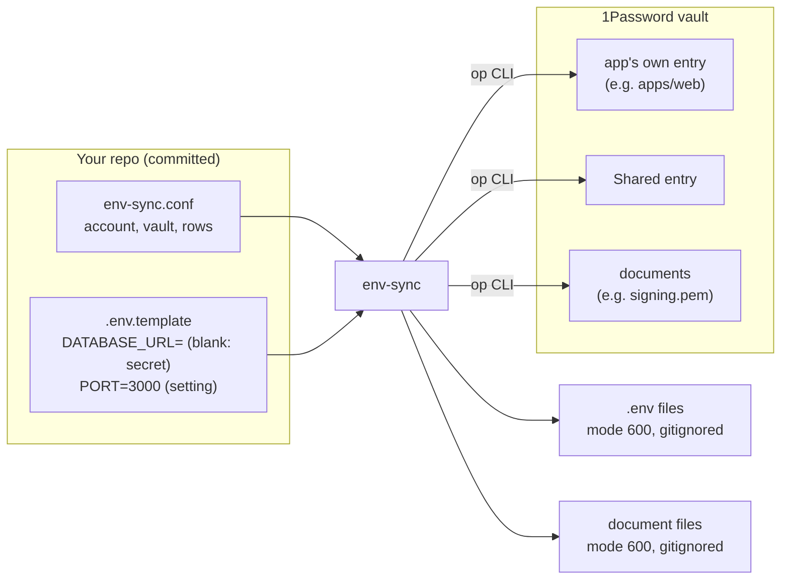
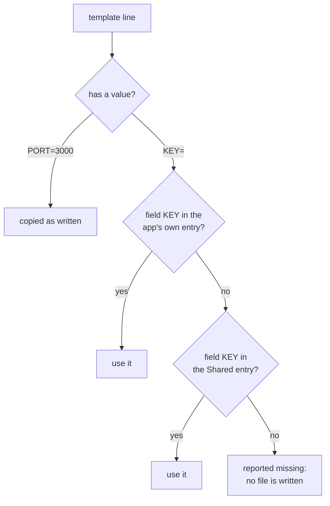

# env-sync

Render `.env` files from 1Password, matching each variable to the 1Password field **with the same name**.

Your repo commits a `.env.template` that lists every variable, with the secret ones left blank. `env-sync pull` fills the blanks from a 1Password vault and writes the real `.env`. No secret ever lives in git, nobody passes values around in chat, and rotating a secret means editing one field in 1Password.

Zero dependencies. Node 20+. Works with any project layout: one app or a monorepo. Runs on macOS, Linux and Windows (PowerShell, Git Bash or WSL; see [Windows](#windows)).

## Install

```sh
npm install -D edl-env-sync     # or: pnpm add -D edl-env-sync / yarn add -D edl-env-sync
npm install -g edl-env-sync     # or globally, to run `env-sync` anywhere
```

A project install puts `env-sync` in `node_modules/.bin`, which your shell does not search. Run it there as `npx env-sync <command>` (or `pnpm exec env-sync` / `yarn env-sync`), or through the [package scripts](#commands) below. To type plain `env-sync`, install it globally as well. Typing `env-sync` after only a project install gives `env-sync: command not found`.

You also need:

- the [1Password CLI](https://developer.1password.com/docs/cli/get-started/) (macOS: `brew install 1password-cli`, Windows: `winget install AgileBits.1Password.CLI`)
- access to the project's 1Password vault

## Commands

The package installs one command, `env-sync`.

```
env-sync pull   [--yes] [--dry-run] [--only <dest>]   write .env files from 1Password (the default)
env-sync check  [--only <dest>]                       exit 1 if any .env is out of date; never writes
env-sync doctor                                       check your setup, and show how to fix each problem
env-sync add KEY [--to <template>] [--app]            add a new secret to 1Password and the template
env-sync setup  [--rehearse] [--vault <name>] [--account <name>] [--source <dir>]
                [--include KEY@path] [--force]        one-time: move a project's existing values into 1Password
env-sync help [command]                               short help for a command
env-sync --version
```

| Flag | Command | Effect |
|---|---|---|
| `--yes`, `-y` | `pull` | write without asking |
| `--dry-run` | `pull` | show what would change, write nothing |
| `--only <dest>` | `pull`, `check` | handle one file, e.g. `--only apps/api/.env` |
| `--to <template>` | `add` | which template gets the key, when there are several |
| `--app` | `add` | store the value in the app's own entry instead of Shared |
| `--rehearse` | `setup` | trial run in a throwaway vault, deleted afterwards |
| `--vault`, `--account` | `setup` | vault to create, 1Password account to use |
| `--source <dir>` | `setup` | read the current values from another checkout |
| `--include KEY@path` | `setup` | upload a key that was excluded as production-looking |
| `--force` | `setup` | overwrite existing templates, or add to a non-empty vault |

If you prefer package scripts, alias them. Hints in env-sync's output then use the form you ran, such as `pnpm env:pull`.

```jsonc
"scripts": {
  "env:pull": "env-sync pull",
  "env:check": "env-sync check",
  "env:add": "env-sync add",
  "env:doctor": "env-sync doctor"
}
```

## How it works

There are three pieces:

| Piece | Lives in | Holds |
|---|---|---|
| `env-sync.conf` | your repo, committed | the 1Password account and vault, and which template becomes which file |
| `.env.template` files | your repo, committed | every variable name; secrets blank, plain settings with their value |
| a vault | 1Password | the secret values, as fields named like the variables |



env-sync never talks to 1Password over the network itself. It runs the local `op` CLI, so it can do exactly what your own 1Password sign-in allows, and nothing more.

### Filling a template

Each line of a template is handled by name:



- The **app's own entry** is titled after the template's directory: `apps/web/.env.template` reads from the entry `apps/web`. It only needs to exist when that app's value differs from everyone else's.
- The **Shared** entry holds everything else, so each secret is rotated in one place.
- `KEY=""` is an intentionally empty setting and is copied as written.
- A `file` row fetches the 1Password **document** titled with the file's name, such as `signing.pem`.

### What `pull` does, in order

1. Finds the repo root (`git rev-parse --show-toplevel`) and reads `env-sync.conf`.
2. Checks that `.env-sync.*` is gitignored. Secrets pass through that scratch folder on their way to disk.
3. Lists the vault's entries, then reads each entry it needs once, with `op item get --reveal`.
4. Renders every template and fetches every document **in memory**. If anything is missing, it names all of it and writes nothing.
5. For each file, shows the change by **name only** (`+` new, `~` changed, `-` dropped) and asks before writing.
6. Writes each file in one step (scratch file, then rename) with mode `600`.

`check` does steps 1–5 and exits `1` if anything differs. `doctor` runs every check top to bottom and explains each failure.

## Configuration

`env-sync.conf`, at the repo root:

```
account = acme                                  # 1Password account (sign-in address or shorthand)
vault   = Acme Dev                              # one vault per project

env  apps/api/.env.template -> apps/api/.env
env  apps/web/.env.template -> apps/web/.env.local
file .secrets/signing.pem                       # a 1Password document titled "signing.pem"
file .secrets/ca.pem mode=400                   # optional mode; owner-only modes only
```

`apps/api/.env.template`:

```
PORT=3000
NODE_ENV=development
DATABASE_URL=
STRIPE_SECRET_KEY=
```

Full reference: [Configuration](docs/configuration.md).

## Signing in

**Recommended:** in the 1Password app, open **Settings → Developer**, turn on **Integrate with 1Password CLI**, and add your account to the app. Each command then asks for Touch ID, and no password or token is handled in the terminal.

Without the app integration, env-sync offers to sign you in with your password the first time a command needs 1Password. It remembers that sign-in for later commands until 1Password expires it, after 30 idle minutes. The session is saved to `~/.cache/env-sync/`, readable only by you, and deleted as soon as 1Password rejects it. To sign out early, run `op signout --account <account>`.

To sign in by hand instead, run `eval $(op signin --account <account>)` in your shell. On Windows the command differs; see below.

## Windows

env-sync 1.3.5 and later runs natively on Windows, in PowerShell or Git Bash. Teammates follow the same steps as on a Mac, with these differences:

1. **Install the CLI** with `winget install AgileBits.1Password.CLI`, and Node 20+.
2. **Use Windows Hello instead of Touch ID.** In the 1Password app, first turn on **Settings → Security → Windows Hello**. The **Settings → Developer → Integrate with 1Password CLI** option only appears after that. With it on, no password or session token touches the terminal. This is the recommended setup.
3. **Signing in by hand.** On Windows, `op signin` prints PowerShell syntax, so the command depends on your shell:

   ```sh
   Invoke-Expression $(op signin --account epicdesignlabs)                        # PowerShell
   eval "$(op signin --account epicdesignlabs | sed 's/^\$env:/export /')"        # Git Bash
   ```

   env-sync's own hints already show only the line for your shell: it recognises Git Bash, and gives every other Windows shell the PowerShell form (cmd users: open PowerShell). Don't run the PowerShell form in Git Bash, or `$(op signin)` without the `sed`. Bash then tries to run the session line as a command, and the error message (`:OP_SESSION_…=…: command not found`) shows your session token. If that happens, run `op signout --account <account>` to end that session.
4. **File permissions.** Windows has no Unix permission bits, so the `600` mode and any `mode=` setting are not applied. Files rely on your user folder's access rules instead, which keep other users of the machine out. env-sync doesn't report this as out of date.

**WSL** works too, as a normal Linux setup. Keep the repo in the Linux home (`~/code/…`), not under `/mnt/c/…`. Files on the Windows drive have no real permissions in WSL, so `check` would always report them out of date.

If you see `cannot create an item from template and stdin at the same time` or `check` always says out of date, you have a version older than 1.3.3. Run `npm install -D edl-env-sync@latest`.

## Everyday use

| You want to… | Run | Then everyone else |
|---|---|---|
| Start on a project | get access to its vault, then `env-sync pull` | — |
| See if you're current | `env-sync check` | — |
| Rotate a secret | edit the field in 1Password | `env-sync pull` |
| Add a secret | `env-sync add STRIPE_SECRET_KEY --to apps/api/.env.template`, then commit the template | `env-sync pull` |
| Use an existing secret in another app | add a blank `KEY=` line to that app's template and commit it | `env-sync pull` |
| Fix a problem | `env-sync doctor` | — |

`add` asks for the value without showing it, refuses a name that already exists (so it can never overwrite the team's value), and reads the value back from 1Password before touching the template.

There is deliberately no push from a laptop to the vault. It would let one person's stale value overwrite the one everyone uses.

## Setting up a new project

Run it once, from the checkout that holds the current `.env` values:

```sh
env-sync setup --vault "Acme Dev" --rehearse   # trial run in a throwaway vault, deleted afterwards
env-sync setup --vault "Acme Dev"              # for real
```

`setup` reads each `.env` file (the ones in `env-sync.conf`, or the gitignored ones it finds) and sorts every key:

- **secret → 1Password**: names like `*_KEY`, `*_SECRET`, `*_TOKEN`, `*_PASSWORD`, connection strings, and anything that looks random. Unknown keys count as secrets, which is the safe direction.
- **setting → template**: ports, hosts, regions, paths, flags, plain URLs.
- **excluded**: anything that looks like production, such as a name containing `PROD`/`PRODUCTION`, a `_live_` key, or a database on a non-local host. The vault is for development. Override a false positive with `--include KEY@path/to/.env`.
- **made portable**: absolute paths inside the repo are rewritten relative to the `.env` file.

When two apps hold different values under one name, the second app gets its own entry. Before writing any template, `setup` renders every template back from 1Password and checks each value against your files. Its output never contains a secret value. Full walkthrough: [Setting up a project](docs/setting-up-a-project.md).

## When something is wrong

Run `env-sync doctor`. It checks Node, the 1Password CLI, the repo, `env-sync.conf`, the `.gitignore` rule, sign-in, vault access, the templates, every variable and document, and whether your files are current. For each problem it shows what 1Password said and the exact command that fixes it. Checks that depend on a failed one are marked skipped.

```
  ✓ Node 22.11.0 (needs 20+)
  ✓ 1Password CLI 2.39.0
  ✗ Not signed in to 1Password (account "acme")
      1Password said: You are not currently signed in.
      Fix: eval $(op signin --account acme)
           Or use Touch ID instead of a password: 1Password → Settings → Developer →
           "Integrate with 1Password CLI", and add your acme account to the app.
  Sign in to 1Password now? [y/N]
```

In a terminal, env-sync offers the safe local fixes (signing in, adding the `.gitignore` rule) and applies them only if you answer yes. Anything that involves other people, like vault access, is only explained. With no terminal attached, as in CI, it never prompts. Every message and its fix: [Troubleshooting](docs/troubleshooting.md).

## Guarantees

- **No secret value is printed, logged, or written to git.** Output shows variable names only.
- **Nothing is half-written.** If any variable or document is missing, no file changes.
- **Files are owner-only and written atomically.** Default mode `600`; a mode that grants group or world access is refused. On Windows, which has no permission bits, files rely on your user folder's access rules.
- **Declining a prompt changes nothing.**
- **The account is pinned** by `env-sync.conf`, so a second signed-in 1Password account can never answer by mistake.
- **`pull`, `check` and `doctor` only read the vault.** Only `setup` and `add` write, and `add` never overwrites.

The limits, including the saved sign-in session and `add`'s brief process-list exposure, are in [Security](docs/security.md).

## Exit codes

| Code | Meaning |
|---|---|
| 0 | OK, nothing out of date |
| 1 | `check` or `doctor` found an out-of-date file, or `setup` verification failed |
| 2 | 1Password CLI missing, or not signed in |
| 3 | vault unreachable, or the project isn't set up yet |
| 4 | a variable or document is not in 1Password |
| 5 | bad config or arguments, or an unsafe repo setup |

## Documentation

The guides ship with the package in [`docs/`](docs/README.md) (also at `node_modules/edl-env-sync/docs/`):

- [Getting started](docs/getting-started.md): joining a project that already uses env-sync
- [Setting up a project](docs/setting-up-a-project.md): moving a project's secrets into 1Password
- [Configuration](docs/configuration.md): `env-sync.conf` and `.env.template`
- [Commands](docs/commands.md): every command, flag and exit code
- [Troubleshooting](docs/troubleshooting.md): every error message and its fix
- [Security](docs/security.md): what it guarantees about your secrets, and the limits

## Development

```sh
npm test
```

The tests run the real CLI against a fake `op` (`test/fake-op/op`). No network, no vault.

Maintained by [Epic Design Labs](https://github.com/Epic-Design-Labs).
